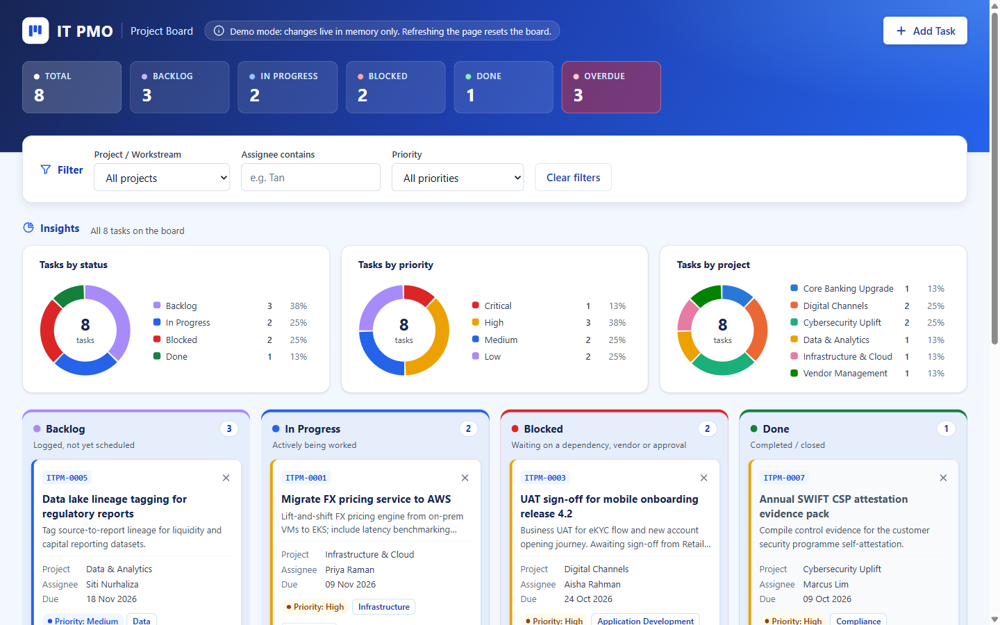

# IT PMO Kanban

     [](https://github.com/xiatianyu11/kanban7/actions/workflows/pages.yml) [](https://github.com/xiatianyu11/kanban7/actions/workflows/ci.yml)

A single-file IT PMO Kanban board for a **fictitious** bank, used as an internal demo and training tool. Everything (markup, styles and script) lives in one `index.html` with no frameworks, no build step and no external resources.

**Live demo:** https://xiatianyu11.github.io/kanban7/ · **Source on GitHub:** https://github.com/xiatianyu11/kanban7



## Features

- Four columns: **Backlog**, **In Progress**, **Blocked** and **Done**, with live counts and a summary bar
- **Insights** pie charts of tasks by status, priority and project. They follow the active filters, show the count and share on hover, and list every slice in a legend so colour is never the only cue
- Blue, minimal design: one colour per status and priority, used by both the board and the charts (palettes checked for colour-blind separation)
- Drag and drop cards between columns (native HTML5 drag and drop)
- Keyboard-friendly **Move** menu on every card as an alternative to dragging
- Filters by project/workstream, assignee and priority
- **Overdue** badges on cards past their due date
- In-card delete confirmation ("Delete? Yes / No"), no browser dialogs
- Toast notifications for actions
- Accessibility: visible focus rings, labelled icon buttons, `aria-live` toasts, priority shown as text as well as colour, and columns that stack below 768px
- Optional email notification for new tasks via [FormSubmit](https://formsubmit.co/)

## Tech stack

Vanilla HTML, CSS and JavaScript in a single file. No frameworks, CDNs, web fonts, package manager or build step.

## How to install

```sh
git clone https://github.com/xiatianyu11/kanban7.git
```

Nothing else to install.

## How to run

- Double-click `index.html`, or
- on Windows: `Start-Process index.html`
- on macOS: `open index.html`
- on Linux: `xdg-open index.html`
- or open the [live GitHub Pages demo](https://xiatianyu11.github.io/kanban7/).

Issues and contributions are welcome at [github.com/xiatianyu11/kanban7](https://github.com/xiatianyu11/kanban7).

## Configuration

New tasks can trigger an email via FormSubmit. Set the endpoint at the top of the script in `index.html`:

```js
const FORMSUBMIT_ENDPOINT = "https://formsubmit.co/ajax/YOUR_EMAIL@example.com";
```

Each new address needs a one-time activation: the first submission sends a confirmation email to that address instead of delivering the notification. If the call fails, the card is still added and a warning toast is shown.

## Notes

- **No persistence.** The board lives in memory only; refreshing the page resets it to the seed data.
- All names, projects and people are fictitious.

## CI/CD

- **`pages.yml`** deploys `index.html` to GitHub Pages on every push to `main` (and on manual dispatch).
- **`ci.yml`** runs on every push and pull request to `main`:
  - **secret-scan**: Gitleaks over the full git history.
  - **constraints**: fails the build if `index.html` breaks the single-file rules: more than one `<style>` or `<script>` block, `!important`, browser storage or cookies, `alert()`/`confirm()`, or any external `src`/`href` resource.
  - **html-validate**: HTML lint, reported but non-blocking.
